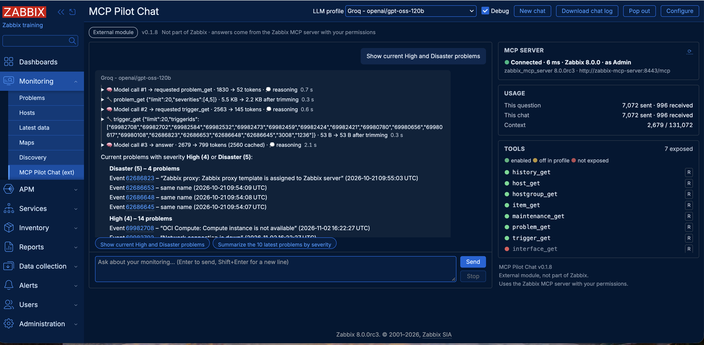
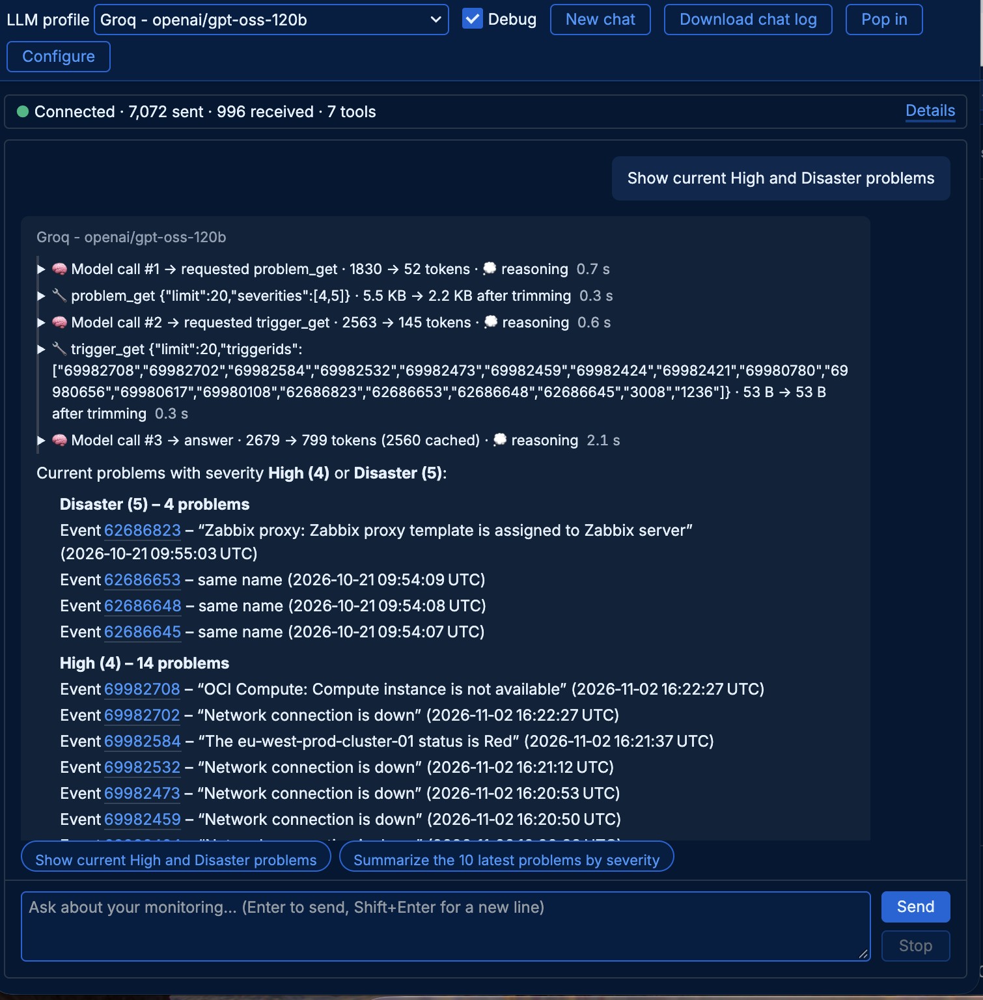
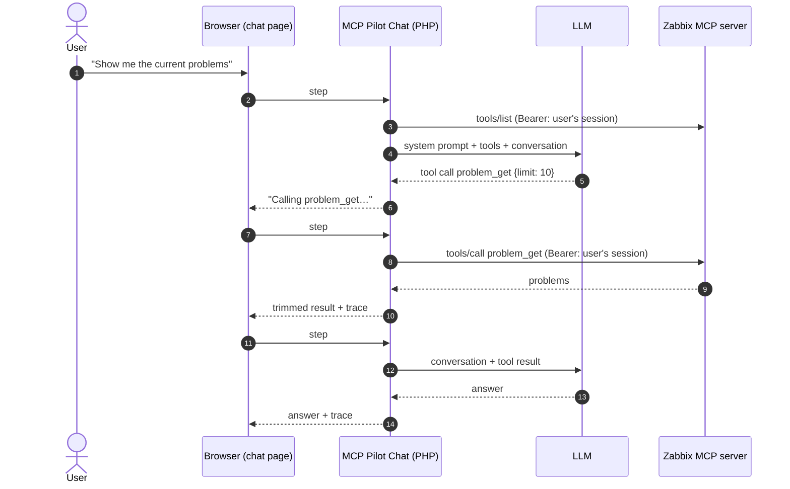

# MCP Pilot Chat

> **External module for Zabbix 8.0. Not part of Zabbix and not supported by Zabbix SIA.**
> A personal project, maintained on a best-effort basis: there is no commitment to fixes or updates.
> See [Support](#support).

An AI chat inside the Zabbix frontend. You ask questions in plain language, and the LLM of your choice answers by
calling the tools of the official **Zabbix MCP server**, with the permissions of the logged-in user. Every tool
call, result and model call is shown, so you can see exactly where each answer comes from.


---

## Contents

- [What it is](#what-it-is)
- [Features](#features)
- [Requirements](#requirements)
- [Quick start](#quick-start)
- [Choosing a model](#choosing-a-model)
- [Usage](#usage)
- [How it works](#how-it-works)
- [Security and privacy](#security-and-privacy)
- [Known limitations](#known-limitations)
- [Documentation](#documentation)
- [Support](#support)
- [Contributing](#contributing)
- [License](#license)

## What it is

MCP Pilot Chat adds **Monitoring → MCP Pilot Chat (ext)** to the Zabbix frontend. The module is the agent: it
sends your question to an LLM together with the tools of the Zabbix MCP server, runs the tool calls the model asks
for, and shows each step live.

```
User ──► MCP Pilot Chat (Zabbix frontend) ──► LLM (local or cloud, OpenAI-compatible)
                     │
                     └──────────────────────► Zabbix MCP server ──► Zabbix API
```

The LLM and the MCP server never talk to each other directly. Only the module knows both.

It was built to show what the Zabbix MCP server can do: the model does all the reasoning, and the module never
adds data of its own.



*An answer from gpt-oss-120b on Groq, with the trace of each model call and MCP tool call. The side panel shows
the MCP server, the token usage and which tools the profile may use.*

## Features

**Zabbix-native**
- A frontend module: no extra containers or services besides the MCP server and an LLM.
- Every MCP call uses the **logged-in user's session**: users see only what their Zabbix permissions allow, and
  calls appear in the Zabbix audit log under their name. No stored Zabbix tokens or passwords; works with
  internal, LDAP, SAML and MFA logins.
- Follows the user's Zabbix theme. Configuration in a Zabbix-style popup, for Super admins only.
- Access per user group, and per profile.

**Any model**
- Any OpenAI-compatible Chat Completions API with tool calling: llama.cpp, Ollama, vLLM, LiteLLM, OpenAI, Claude
  API, Google Gemini, Groq, OpenRouter and others. A Generic HTTP adapter (request template) covers the rest.
- Several **LLM profiles**, switchable in the chat: for example a local model and a cloud model.
- **Provider presets** with known-good settings, marked *tested* or *untested*.
- Options for **small local models**: a lean set of result fields, *Require a tool call* on the first step,
  limits on result sizes, editable system prompts.
- Automatic retries with a countdown when a provider is rate limited or busy.

**Transparent**
- A live trace of each answer: every model call (tokens, time) and every MCP tool call (arguments, raw and trimmed
  result, size, time), with a live timer while waiting.
- **Usage** per question and per chat, in tokens. The context size of the last request.
- MCP server status and the list of tools: exposed and allowed, exposed but off in the profile, or not exposed.
- **Download chat log**: the whole conversation with every model and MCP call as JSON.

**Safe by default**
- Write tools need the user's approval for each call.
- The session ID never reaches the browser or the LLM; API keys are never sent back to the browser.

**Comfortable**
- Answers in Markdown, with links to the Zabbix pages of events, hosts and triggers that appeared in tool results.
- The current chat survives page reloads. **Pop out** keeps the chat in its own window while you use Zabbix: it
  fits any window size (a one-line status bar replaces the side panel in narrow windows) and remembers its size.
- Starter questions per profile (each provider preset brings its own), a Stop button, and a debug toggle.


## Requirements

| Component | Version and notes |
|---|---|
| Zabbix frontend | 8.0 |
| Zabbix MCP server | 8.0, the same version as the frontend, reachable from the frontend over HTTP |
| PHP | 8.1 or newer with the `curl` extension (the official Zabbix 8.0 images include it) |
| LLM | Any OpenAI-compatible Chat Completions API **with tool calling** |
| Web server | A request timeout at least as long as the profile's LLM timeout (see [installation](docs/installation.md#web-server-timeout)) |

## Quick start

1. **Run the Zabbix MCP server** and allow the read tools you want the model to use. See
   [docs/installation.md](docs/installation.md#1-zabbix-mcp-server).
2. **Install the module** in the frontend's `modules` folder:
   ```bash
   cd /usr/share/zabbix/modules
   git clone https://github.com/vittoriocioe/zabbix8-mcp-pilot-chat.git mcp-pilot-chat
   ```
   Or download a release and unpack it there. For containerized frontends, mount the folder into the container:
   [docs/installation.md](docs/installation.md#2-install-the-module).
3. In Zabbix, open **Administration → General → Modules**, click **Scan directory**, and enable
   **MCP Pilot Chat**.
4. Open **Monitoring → MCP Pilot Chat (ext)** and click **Configure** (Super admins only):
   - **MCP server** tab: enter the server URL, e.g. `http://zabbix-mcp-server:8443/mcp`, and click
     **Test connection**.
   - **LLM profiles** tab: pick a **preset** for your provider and click **Add as new profile** (or apply it to the
     example profile). Enter the API key if the provider needs one, then click **Test connection**.
   - **Access & UI** tab: choose which user groups may use the chat and the default profile.
5. Save, and ask your first question: *Show current High and Disaster problems*.

The default configuration expects an MCP server at `http://zabbix-mcp-server:8443/mcp` and a local llama.cpp
server at `http://demo-llm:8080/v1`, as in the [Podman lab example](docs/lab-podman.md).

## Choosing a model

The quality of the answers depends almost entirely on the model. The module works the same way with all of them.

| Model | Tested result |
|---|---|
| Claude Haiku (Claude API) | Best results: correct multi-step answers, combines several tools. Paid, about half a US cent per question in testing. |
| gpt-oss-120b (Groq, free tier) | Fast and accurate for one or two tool calls. The free tier allows 8,000 tokens per minute: allow only the tools you need and leave a minute between questions. |
| Gemini Flash-Lite (Google, free tier) | Works, but free-tier models are often busy (retried automatically). |
| Qwen3 0.6B (llama.cpp, local) | Calls a tool and lists the result reliably; miscounts, cannot compare or combine. Enough to show the MCP tool chain on very small hardware, with all data staying local. |

Settings for each provider and more test notes: [docs/llm-providers.md](docs/llm-providers.md).

## Usage

1. Open **Monitoring → MCP Pilot Chat (ext)** and pick a profile.
2. Type a question, or click a starter prompt. Press Enter to send, Shift+Enter for a new line.
3. Watch the trace while the answer is built: each model call and each tool call is a step. With **Debug** on,
   steps can be expanded to show arguments, results and the messages sent to the model.
4. Write tools (if the MCP server and the profile allow them) show an **Approve / Deny** card first.
5. **New chat** starts over. Switching the profile also starts a new chat.
6. **Pop out** opens the chat in its own window without the Zabbix menu; links in answers open in the main
   window. In a narrow window, a status line shows the connection, tokens and tools; **Details** opens the full
   side panel. The window opens at the size you last gave it. **Pop in** moves the chat back.

   

7. **Download chat log** saves the conversation as JSON, for example to attach to a bug report.

Good first questions: *Show current High and Disaster problems*, *Show the 5 latest problems*,
*Are there unacknowledged Disaster problems?*

## How it works



- **The browser drives the loop.** Each backend request does exactly one LLM call or one MCP call, so progress is
  shown live and no single request runs for the whole answer.
- **The conversation state is kept by the browser,** signed with a key bound to the user's session, so it cannot be
  changed to inject tool calls or approvals.
- **Pure AI.** The model decides which tools to call and combines the results. The module only removes noise
  fields from tool results (configurable per profile) and formats timestamps. Every fact in an answer can be traced
  to a tool call in the trace.

The full design is in [docs/specification.md](docs/specification.md).

## Security and privacy

- **Permissions:** the MCP server acts with the logged-in user's session, so the chat can only see and do what that
  user can in Zabbix.
- **Data sent to the LLM:** tool results (problem, trigger and host names, and whatever else the allowed tools
  return) go to the configured LLM. With a cloud provider, this data leaves your network. Use a local model if
  that is not acceptable.
- **Secrets:** the session ID stays on the server. LLM API keys are stored in the module configuration in the
  Zabbix database (not encrypted), are write-only in the configuration popup and are never sent to the browser.
- **Write tools:** deny them on the MCP server unless you need them. If allowed, each call needs the user's approval
  (a Super admin can turn this off per profile; the chat then shows a warning).
- **Prompt injection:** tool results can contain text from monitored systems, which can influence the model. Keep
  approval on for write tools.

More in [SECURITY.md](SECURITY.md), including how to report a vulnerability.

## Known limitations

- **Problems do not come with host names.** The Zabbix MCP server's `problem_get` and `trigger_get` return no host,
  and `host_get` cannot be filtered by trigger. A model can still find the host (list hosts with their triggers
  and match the trigger IDs, or ask per host), which works for capable models on small installations but not for
  small local models.
- **MCP results cannot be paged.** Results stop at the tool's `limit` or the server's maximum response size;
  the trace marks truncated results. The model has to narrow its queries instead.
- **Small models are limited.** A 0.6B model can call one tool and list the result; it cannot compare, count
  reliably or combine tools. It can also copy an earlier answer from the conversation: start a new chat.
- **Tested with Zabbix 8.0 development images** (`alpine-trunk`) in a lab. Status: alpha.
- With the Claude API, **Test connection** cannot list models; the chat works.

## Documentation

- [Installation](docs/installation.md): MCP server, module, web server timeout, upgrading, troubleshooting
- [LLM providers](docs/llm-providers.md): presets, tested providers and models, small-model tips
- [Podman lab example](docs/lab-podman.md): a complete lab with Quadlets and a tiny local model
- [Specification](docs/specification.md): architecture, loop, configuration, UI and security in detail
- [Changelog](CHANGELOG.md)

## Support

MCP Pilot Chat is a personal project, shared as is and maintained on a best-effort basis in my spare time. There
is no commitment to answer issues, fix bugs, publish updates or support new Zabbix versions, and no timeline for
any of them. Issues and pull requests are welcome, and I will look at them when I can.

The software comes without any warranty, as stated in the [license](LICENSE). Try it in a test environment first;
use in production is at your own risk. For Zabbix itself, use Zabbix's own support channels: this module is not a
Zabbix product.

## Contributing

Bug reports, test results with other models, and pull requests are welcome. See
[CONTRIBUTING.md](CONTRIBUTING.md) for how to run the tests (no Zabbix installation needed) and the design rules.

## License

Copyright (C) 2026 Vittorio Cioe.

Licensed under the [GNU Affero General Public License v3.0](LICENSE) (AGPL-3.0-only), the same license as Zabbix.

MCP Pilot Chat is an independent, community-built external module. It is not developed, endorsed or supported by
Zabbix SIA. "Zabbix" is a trademark of Zabbix SIA.
