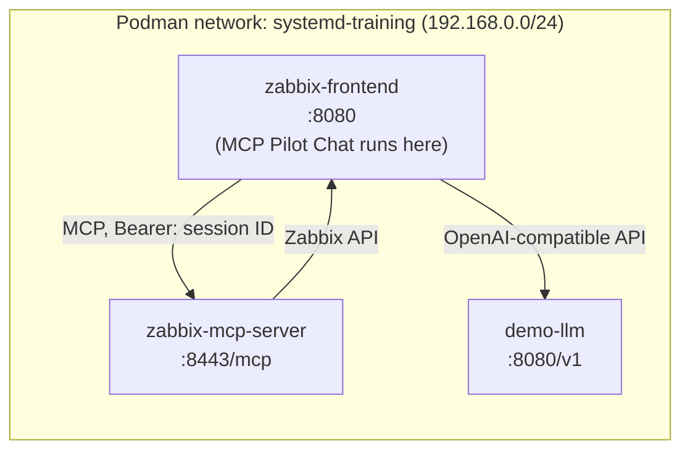

# Podman lab example

This guide reproduces the lab MCP Pilot Chat was developed and tested in: a containerized **Zabbix 8.0** on
**Podman** with Quadlets, plus the **Zabbix MCP server** and a **tiny local LLM**. The Quadlet files are in
[`deploy/`](../deploy/). For a general installation, see [installation.md](installation.md).

> The LLM part is sized for a demo on a small VM. It proves the tool-calling chain end to end; for good answers
> use a bigger model on other hardware or a cloud API ([llm-providers.md](llm-providers.md)).

## Contents

- [Lab topology](#lab-topology)
- [Prerequisites](#prerequisites)
- [1. Zabbix MCP server](#1-zabbix-mcp-server)
- [2. Local LLM (llama.cpp + Qwen3 0.6B)](#2-local-llm-llamacpp--qwen3-06b)
- [3. Verify the chain](#3-verify-the-chain)
- [Verify session authentication](#verify-session-authentication)
- [4. Install the MCP Pilot Chat module](#4-install-the-mcp-pilot-chat-module)
- [Troubleshooting](#troubleshooting)

## Lab topology



No ports are published to the host. All traffic stays on the internal Podman network.

| Container | Image | Memory limit | Purpose |
|---|---|---|---|
| `zabbix-mcp-server` | `docker.io/zabbix/zabbix-mcp-server:alpine-trunk` | 128 MB (uses ~20 MB) | Official Zabbix MCP server |
| `demo-llm` | `ghcr.io/ggml-org/llama.cpp:server` | 1 GB | Qwen3 0.6B (Q4_K_M) with tool calling |

## Prerequisites

- Zabbix 8.0 running in Podman containers managed by Quadlets
  (here all images use the `alpine-trunk` tag, matching the MCP server image).
- The frontend container `zabbix-frontend` on the network `systemd-training`.
- Quadlet directory: `/usr/share/containers/systemd/` (rootful). `/etc/containers/systemd/` works too.

Find your network and subnet:

```bash
podman inspect zabbix-frontend \
  --format '{{range $k,$v := .NetworkSettings.Networks}}{{$k}} {{$v.IPAddress}}{{"\n"}}{{end}}'
podman network inspect systemd-training --format '{{range .Subnets}}{{.Subnet}}{{end}}'
```

## 1. Zabbix MCP server

Quadlet: [`deploy/zabbix-mcp-server.container`](../deploy/zabbix-mcp-server.container)

```ini
[Container]
ContainerName=zabbix-mcp-server
Image=docker.io/zabbix/zabbix-mcp-server:alpine-trunk
Network=systemd-training
Environment=ZBX_FRONTEND_URL=http://zabbix-frontend:8080/api_jsonrpc.php
Environment=ZBX_ALLOWEDIP=192.168.0.0/24
Environment=ZBX_ALLOWTOOL_0=problem_get
Environment=ZBX_ALLOWTOOL_1=trigger_get
Environment=ZBX_ALLOWTOOL_2=host_get
Environment=ZBX_ALLOWTOOL_3=hostgroup_get
Environment=ZBX_ALLOWTOOL_4=maintenance_get
Environment=ZBX_DENYTOOL_5=*
PodmanArgs=--memory=128m --cpus=0.5
```

Key points:

- `ZBX_FRONTEND_URL` must end with `api_jsonrpc.php`. Port `8080` is the internal port of the official web images.
- `ZBX_ALLOWEDIP` lists the clients allowed to connect. The subnet is needed for testing from other containers or the host; in production narrow it to `zabbix-frontend` (DNS names are accepted).
- **Tool rules** are indexed, start at `0`, must have **no gaps and no duplicates**, and the first matching rule wins. This configuration exposes five read-only tools and denies everything else, including all write tools.
- Plain wildcard rules are used instead of regex rules, so the Quadlet contains no `$` that systemd could try to expand.

Optional, to let the model see metric values (denied by default by Zabbix because item keys and history may contain sensitive data):

```ini
Environment=ZBX_ALLOWTOOL_5=item_get
Environment=ZBX_ALLOWTOOL_6=history_get
Environment=ZBX_DENYTOOL_7=*
```

Install and start:

```bash
cp deploy/zabbix-mcp-server.container /usr/share/containers/systemd/
systemctl daemon-reload
systemctl start zabbix-mcp-server
journalctl -u zabbix-mcp-server -n 5 --no-pager
```

Expected last log line: `MCP endpoint available at http://0.0.0.0:8443/mcp, 5 tools exposed`.

## 2. Local LLM (llama.cpp + Qwen3 0.6B)

Quadlet: [`deploy/demo-llm.container`](../deploy/demo-llm.container)

```ini
[Container]
ContainerName=demo-llm
Image=ghcr.io/ggml-org/llama.cpp:server
Network=systemd-training
Volume=demo-llm-models:/models
Environment=LLAMA_CACHE=/models
Exec=-hf unsloth/Qwen3-0.6B-GGUF:Q4_K_M --jinja -c 4096 -np 1 -t 1 --host 0.0.0.0 --port 8080 --chat-template-kwargs '{"enable_thinking":false}'
PodmanArgs=--memory=1g --cpus=1

[Service]
Restart=always
TimeoutStartSec=900
```

| Option | Why |
|---|---|
| `-hf …:Q4_K_M` | Downloads the model (~400 MB) on first start; cached in the `demo-llm-models` volume |
| `--jinja` | Uses the model's chat template; **required for tool calling** |
| `-c 4096` | 4k context: enough for a few tool schemas plus trimmed results |
| `-np 1 -t 1` | One request at a time, one CPU thread, so Zabbix is not starved |
| `--chat-template-kwargs '{"enable_thinking":false}'` | Disables Qwen3's reasoning text. Cut a tool-call response from 110 to 21 tokens (~48 s → ~7 s) |
| `--memory=1g` | If memory runs out, this container is killed, not mysqld |
| `TimeoutStartSec=900` | Time for the first image pull and model download |

Install and start:

```bash
cp deploy/demo-llm.container /usr/share/containers/systemd/
systemctl daemon-reload
systemctl start demo-llm
journalctl -u demo-llm -f     # wait for "listening on http://0.0.0.0:8080"
```

The warnings `no API key is set` and `'</s>' was not control-type` are harmless here.
To protect the endpoint, add `--api-key <secret>` to `Exec=` and set the same key in the module profile.

## 3. Verify the chain

All commands run on the host and reach the containers by their IP on the Podman bridge.

Helper:

```bash
ip() { podman inspect -f '{{range .NetworkSettings.Networks}}{{.IPAddress}}{{end}}' "$1"; }
TOKEN=<zabbix-api-token-or-session-id>
```

**MCP: list tools**

```bash
curl -sS http://$(ip zabbix-mcp-server):8443/mcp \
  -H "Authorization: Bearer $TOKEN" -H "Content-Type: application/json" \
  -H "Accept: application/json, text/event-stream" \
  -d '{"jsonrpc":"2.0","id":1,"method":"tools/list"}'
```

**MCP: call a tool**

```bash
curl -sS http://$(ip zabbix-mcp-server):8443/mcp \
  -H "Authorization: Bearer $TOKEN" -H "Content-Type: application/json" \
  -H "Accept: application/json, text/event-stream" \
  -d '{"jsonrpc":"2.0","id":2,"method":"tools/call","params":{"name":"problem_get","arguments":{"limit":5}}}'
```

**LLM: tool call**

```bash
curl -sS http://$(ip demo-llm):8080/v1/chat/completions -H "Content-Type: application/json" \
  -d '{"messages":[{"role":"user","content":"Show me the current problems in Zabbix"}],
       "tools":[{"type":"function","function":{"name":"problem_get","description":"List current Zabbix problems",
       "parameters":{"type":"object","properties":{"limit":{"type":"integer"}}}}}]}'
```

Expected: `"finish_reason":"tool_calls"` with `problem_get` and an empty `content`.

**LLM: answer from a tool result** (the step the module performs after the MCP call)

```bash
curl -sS http://$(ip demo-llm):8080/v1/chat/completions -H "Content-Type: application/json" -d @- <<'EOF'
{
  "messages": [
    {"role": "system", "content": "You are a Zabbix monitoring assistant. Answer briefly using only the data returned by tools."},
    {"role": "user", "content": "Show me the current problems in Zabbix"},
    {"role": "assistant", "content": "", "tool_calls": [
      {"id": "call1", "type": "function", "function": {"name": "problem_get", "arguments": "{\"limit\": 2}"}}]},
    {"role": "tool", "tool_call_id": "call1", "content": "{\"results\":[{\"name\":\"High CPU utilization\",\"severity\":\"Warning\"},{\"name\":\"Network connection is down\",\"severity\":\"High\"}],\"count\":2}"}
  ],
  "tools": [{"type":"function","function":{"name":"problem_get","description":"List current Zabbix problems",
            "parameters":{"type":"object","properties":{"limit":{"type":"integer"}}}}}]
}
EOF
```

Expected: `"finish_reason":"stop"` and a short answer listing the problems.

## Verify session authentication

MCP Pilot Chat authenticates to MCP with the user's frontend session ID.
A session ID from `user.login` is the same kind of session, so it can be used to test:

```bash
SID=$(curl -sS http://$(ip zabbix-frontend):8080/api_jsonrpc.php -H "Content-Type: application/json" \
  -d '{"jsonrpc":"2.0","method":"user.login","params":{"username":"<USER>","password":"<PASSWORD>"},"id":1}' \
  | sed 's/.*"result":"\([^"]*\)".*/\1/')

curl -sS http://$(ip zabbix-mcp-server):8443/mcp \
  -H "Authorization: Bearer $SID" -H "Content-Type: application/json" \
  -H "Accept: application/json, text/event-stream" \
  -d '{"jsonrpc":"2.0","id":1,"method":"tools/list"}'
```

If the tool list is returned, session-based authentication works.

## 4. Install the MCP Pilot Chat module

The official frontend image serves the frontend from `/usr/share/zabbix`, so the module is mounted into
`/usr/share/zabbix/modules/mcp-pilot-chat`.

1. Put the module on the host (the repository root is the module directory):

   ```bash
   mkdir -p /opt/zabbix/modules && cd /opt/zabbix/modules
   git clone https://github.com/vittoriocioe/zabbix8-mcp-pilot-chat.git mcp-pilot-chat
   chmod -R a+rX mcp-pilot-chat
   ```

   The `docs/`, `deploy/` and `tests/` folders are not needed at runtime and can be left out.

2. Add a volume to the frontend Quadlet (for example `/usr/share/containers/systemd/zabbix-frontend.container`),
   in the `[Container]` section:

   ```ini
   Volume=/opt/zabbix/modules/mcp-pilot-chat:/usr/share/zabbix/modules/mcp-pilot-chat:ro,Z
   ```

   Then restart the frontend:

   ```bash
   systemctl daemon-reload
   systemctl restart zabbix-frontend
   podman exec zabbix-frontend ls /usr/share/zabbix/modules/mcp-pilot-chat
   ```

3. In Zabbix, open **Administration → General → Modules**, click **Scan directory**, then enable
   **MCP Pilot Chat**. The default configuration from `manifest.json` already points to
   `http://zabbix-mcp-server:8443/mcp` and `http://demo-llm:8080/v1`.

4. Open **Monitoring → MCP Pilot Chat (ext)**. As Super admin, click **Configure** and use
   **Test connection** on the MCP tab and on the profile.

5. The example profile uses a 600 s timeout for the slow local model. Make sure nginx in the frontend container
   allows that long: [installation.md](installation.md#web-server-timeout).

## Troubleshooting

| Symptom | Cause | Fix |
|---|---|---|
| MCP container exits: `index N is used by both …` | Duplicate tool-rule index | Indices must be unique and consecutive from 0 |
| MCP `400` | `Accept` header missing a media type | Send `Accept: application/json, text/event-stream` |
| MCP `401` | No `Authorization` header | Add `Authorization: Bearer <token or session ID>` |
| MCP `403` | Client IP not in `ZBX_ALLOWEDIP` | Add the client IP, subnet or DNS name |
| LLM answers start with reasoning text and `</think>` | Thinking mode on | Keep `--chat-template-kwargs '{"enable_thinking":false}'` |
| `demo-llm` image pull times out in systemd | 5-minute pull limit | `podman pull ghcr.io/ggml-org/llama.cpp:server`, then restart the service |
| `demo-llm` exits with code 137 | 1 GB memory limit hit | Free memory on the VM or lower `-c` |
| Whole VM slow, swapping | Too little RAM | Stop unused heavy services; run the LLM on other hardware |

Module errors and LLM errors: [installation.md](installation.md#troubleshooting),
[llm-providers.md](llm-providers.md#troubleshooting).
