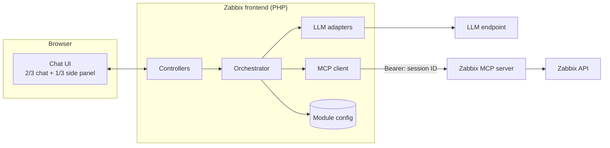
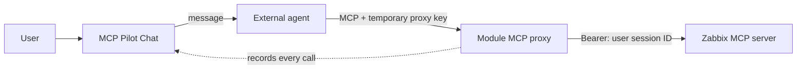

# MCP Pilot Chat: Specification

> External module for Zabbix 8.0. Status: **v0.1.8, alpha**. Tested with automated tests against mock MCP and
> LLM servers, and in a lab Zabbix 8.0 frontend (development images) with Qwen3 0.6B on llama.cpp, Groq, Claude API
> and Google Gemini.

## Contents

1. [Goals and non-goals](#1-goals-and-non-goals)
2. [Architecture](#2-architecture)
3. [Authentication](#3-authentication)
4. [Orchestration loop](#4-orchestration-loop)
5. [Context assembly](#5-context-assembly)
6. [LLM profiles](#llm-profiles)
7. [Adapters](#7-adapters)
8. [Module configuration](#8-module-configuration)
9. [User interface](#9-user-interface)
10. [Tool catalog](#10-tool-catalog)
11. [Debug data](#11-debug-data)
12. [Error handling](#12-error-handling)
13. [Security](#13-security)
14. [Phase 2: external agents via MCP proxy](#14-phase-2-external-agents-via-mcp-proxy)
15. [Naming and identification](#15-naming-and-identification)
16. [Open items](#16-open-items)

---

## 1. Goals and non-goals

### Goals
- Chat with Zabbix data from inside the frontend using any tool-calling LLM.
- Use the **Zabbix MCP server as the only tool source**.
- Run every MCP call **with the permissions of the logged-in user**.
- Make every step of the agent loop **visible** (tools, arguments, results, timings).
- Be **universal**: any OpenAI-compatible endpoint, from a 0.6B local model to cloud APIs.

### Non-goals
- **The module never queries the Zabbix API on its own to add data to tool results.**
  All Zabbix data reaches the model through MCP tool calls the model makes itself ("pure AI").
- No storage of user credentials or API tokens.
- No bundled LLM runtime.

### Pure AI: who does what
| | The model | The module |
|---|---|---|
| Decides which tools to call | ✅ | ❌ |
| Combines, correlates and enriches data from tool results (e.g. matches a problem's trigger ID to a host from `host_get`) | ✅ | ❌ |
| Executes the tool calls the model requested | ❌ | ✅ |
| Removes noise fields from results (see [result trimming](#result-trimming)) | ❌ | ✅ |
| Fetches extra data or adds facts the model did not ask for | ❌ | ❌ |

Every fact in an answer can therefore be traced to a tool call shown in the debug details.

## 2. Architecture



### Components

| Component | Responsibility |
|---|---|
| **Chat UI** (JS) | Renders messages and debug blocks, drives the loop step by step, shows tool and status panels |
| **Controllers** (PHP actions) | Endpoints for steps, status, configuration and connection tests; enforce access rights |
| **Orchestrator** | Decides the next step, keeps loop state, applies iteration limits and approvals |
| **LLM adapters** | Translate the internal message format to and from each LLM API |
| **MCP client** | Streamable HTTP JSON-RPC client: `initialize`, `tools/list`, `tools/call`, `resources/read` |
| **Module config** | MCP settings, profiles, access rules |

### Why the browser drives the loop
A full answer may need several LLM and tool calls; with a small CPU-only model
this can take minutes. Running it in one PHP request would hit PHP-FPM and
nginx/Apache timeouts and block a worker. Instead, **each request performs one
step** and returns; the browser immediately requests the next step. Benefits:
no timeout tuning, live progress ("calling problem_get…"), and a working **Stop** button.

## 3. Authentication

### MCP: current user's session
- The module reads the **frontend session ID** of the logged-in user from the frontend's user context.
- Every MCP request carries `Authorization: Bearer <session ID>`.
- The MCP server forwards the header to the Zabbix API, which validates it as a regular session.

| Property | Result |
|---|---|
| Permissions | Exactly those of the logged-in user |
| Audit log | Actions recorded under the logged-in user |
| Lifetime | Ends at logout or auto-logout |
| Auth methods | Internal, LDAP, SAML, MFA (no password involved) |
| Exposure | Server-side only; never sent to the browser or the LLM |

Verified in the lab: the MCP server accepts the frontend session ID (and a session ID from `user.login`) as a
Bearer token. To check it by hand, see [lab-podman.md](lab-podman.md#verify-session-authentication).

### LLM: per-profile API key
- Optional key per profile, sent as `Authorization: Bearer <key>` (or a custom header for Generic HTTP).
- Stored in the module configuration, masked in the UI, never returned to the browser.

## 4. Orchestration loop

### Request actions

The browser posts to `mcppilotchat.step` with one of these actions. Each request performs **at most one**
LLM call or **one** MCP tool call, then returns.

| Action | What the server does |
|---|---|
| `send` | Adds the user's message, then runs one step |
| `step` | Runs the next tool call if one is pending, otherwise one LLM call |
| `approve` | Marks the pending write call as approved and runs it |
| `deny` | Drops the pending write call and tells the model it was denied |

Response: `next` (`step` = call again, `approval` = show the approval card, `done`), `events` (what
happened in this step: `llm`, `tool`, `notice`, `answer`), `prompt_tokens`, `context_size`, plus the new state.
Tool events also carry `truncated` (and `limit`, `truncated_by`, `count` when true) from the MCP result, shown as
a "truncated at N, cannot be paged" marker in the trace. The model receives the result unchanged.

### State
Zabbix 8.0 keeps the frontend session in an **encrypted cookie**, which is too small for chat history.
The conversation state is therefore held **by the browser** and sent with every request, as an opaque JSON
string **signed with an HMAC keyed by the user's session ID**:

```json
{
  "v": 1,
  "profile_id": "local-demo",
  "messages": [ "...OpenAI Chat Completions format..." ],
  "pending": [ { "id": "call_1", "name": "problem_get", "arguments": {"limit": 10}, "approved": false } ],
  "iteration": 2,
  "last_call": { "prompt_tokens": 1830, "chars": 5120, "overhead_chars": 4200 }
}
```

Assistant messages keep the provider's **tool-call objects exactly as received** (only `arguments` is made a
JSON string and the streaming-only `index` is dropped). Providers may attach data they need to see again in the
next request, e.g. Gemini 3's `extra_content.google.thought_signature` (HTTP 400 without it); echoing the whole
object works for every provider without special cases. `last_call` records the size of the last model request,
to estimate the next one.

- The browser cannot change the state: a modified state or signature is rejected, so it cannot inject
  tool calls, tool results or approvals.
- A state from another login session is rejected ("Start a new chat").
- The state contains tool results, which the logged-in user may see anyway; it contains no credentials.

### Rules
- **Max iterations** per user question (profile setting, default `8`). When reached, the loop stops with a notice.
- **Tool allow-list** per profile: tools not on the list are not offered to the model; a call to an unlisted tool is rejected and reported back to the model as an error.
- **Maximum limit** per profile (default `50`, `0` = none): a tool call whose `limit` argument is higher is refused with an error result that tells the model the maximum, so it can ask again with less. The built-in prompt states it through `{{max_limit}}`.
- **Write tools** (from MCP annotations `readOnlyHint: false`) require approval when approval mode is on.
- **Stop** cancels the loop after the current step; partial results stay visible.

## 5. Context assembly

Order of each LLM request:

1. **System prompt** (profile)
2. **Tool definitions** (from `tools/list`, filtered by the allow-list)
3. **Conversation history**
4. **Tool results** of the current loop (trimmed)

Items 1–2 are kept **byte-identical across requests**, so LLM servers with prompt
caching (e.g. llama.cpp) reuse them and avoid re-reading them on every turn.

### Result trimming
Pure-AI rule: the module may **remove noise fields**, but never adds or derives data.

Default kept fields:

| Tool | Kept fields |
|---|---|
| `problem_get` | `eventid`, `objectid`, `name`, `severity`, `clock`, `acknowledged`, `suppressed`, `opdata` |
| `trigger_get` | `triggerid`, `description`, `priority`, `value`, `lastchange`, `opdata` |
| `host_get` | `hostid`, `host`, `name`, `status`, `maintenance_status`, `triggers[].triggerid`, `triggers[].description`, `triggers[].priority`, `triggers[].value`, `triggers[].opdata` |
| `hostgroup_get` | `groupid`, `name` |
| `maintenance_get` | `maintenanceid`, `name`, `active_since`, `active_till` |
| other | unchanged |

Field lists are editable per profile. A **lean preset for small models** keeps only what is needed to
list and summarize (for `problem_get`: `eventid`, `name`, `severity`, `clock`, `opdata`), roughly halving the tokens.
`opdata` (the trigger's operational data, e.g. "Current utilization: 98.3 %") is dropped when empty, which it is
for most triggers.
Of the response envelope only `count`, `truncated` and `limit` are kept; the long `note` is dropped
because the system prompt explains truncation. Value formatting (e.g. Unix time → ISO date) is
treated as presentation, not new data, and can be disabled.

### System prompts

Three levels, all editable in the configuration popup and resettable:

| Level | Where | Reset |
|---|---|---|
| **Built-in prompt** | Shipped with the module (`Prompts::BUILT_IN`) | – |
| **Module default prompt** | **Prompts** tab. Prefilled with the built-in text. Stored empty while identical to it, so it follows module updates | *Reset to built-in* |
| **Profile prompt** | **LLM profiles** tab: *Use the module default prompt* or *Custom prompt* (starts as a copy of the module default) | *Reset to module default*, *Reset to built-in* |

Each editor shows an approximate token count, because the model reads the prompt on every call.
Placeholders: `{{default_limit}}` (the profile's default limit) and `{{date}}`.

The built-in prompt includes what testing with a 0.6B model showed is needed: always call a tool before
answering about Zabbix data, `count` is the number of results returned and not the total, and a truncated
result must be reported as "showing the latest N".

### Require a tool call on the first step (per profile)

Small models often answer without looking at Zabbix, especially after small talk: the earlier answers in the
history teach them to answer directly ("Hello" followed by "Which problems…?" gets "No issues found").
When enabled, the **first model call of each question** is sent with `tool_choice: "required"`, so the model
must call a tool before it can answer. Later calls use `"auto"`, so the model can still answer.
It stays pure AI: the model chooses the tool and its arguments and writes the answer.

Off by default; on in the demo profile. **Test connection** checks that the LLM server honors it.

## LLM profiles

Defaults for a new profile. The example profile *Local demo* in `manifest.json` uses the values of the
*Local small model* preset instead (see [provider presets](#provider-presets)).

| Field | Type | Default | Notes |
|---|---|---|---|
| `id` | string | – | Unique key |
| `name` | string | – | Shown in the dropdown |
| `adapter` | enum | `openai` | `openai`, `generic_http` |
| `base_url` | URL | – | e.g. `http://demo-llm:8080/v1` |
| `api_key` | secret | empty | Masked, never returned to the browser |
| `model` | string | – | Sent as `model` |
| `prompt_mode` | enum | `default` | `default` = module default prompt, `custom` = `system_prompt` |
| `system_prompt` | text | empty | Custom prompt, used when `prompt_mode` is `custom` |
| `require_tool_first` | bool | `false` | `tool_choice: "required"` on the first model call of each question |
| `temperature` | float | `0.2` | Empty = not sent (some providers reject other values) |
| `max_tokens` | int | `512` | Per LLM response |
| `context_size` | int | `8192` | For the context number in the Usage card and the "start a new chat" hint |
| `max_iterations` | int | `8` | Per user question |
| `default_limit` | int | `10` | Suggested `limit` in the system prompt (`{{default_limit}}`) |
| `max_limit` | int | `50` | Highest `limit` a tool call may ask for; `0` = none (`{{max_limit}}`) |
| `tool_allowlist` | list | all exposed | Controls 🟢 vs 🟡 in the tool panel |
| `trim_fields` | map | defaults | Per-tool kept fields. The popup offers a **lean preset for small models** |
| `extra_params` | JSON | `{}` | Merged into the request, e.g. `{"chat_template_kwargs":{"enable_thinking":false}}` |
| `timeout` | int | `120` s | Per LLM call |
| `starter_prompts` | list | empty | Clickable suggestions |
| `user_groups` | list | all chat users | Who may select this profile |
| `approval_required` | bool | `true` | For write tools |

### Provider presets

`lib/Presets.php` holds known settings per provider, offered in *Configure → LLM profiles*:

| Preset | Base URL | Model | Status |
|---|---|---|---|
| Local small model (llama.cpp) | `http://demo-llm:8080/v1` | `qwen3-0.6b` | tested |
| Ollama | `http://ollama:11434/v1` | – (pick one with tool calling) | untested |
| OpenAI | `https://api.openai.com/v1` | – | untested |
| Claude API (Anthropic) | `https://api.anthropic.com/v1` | `claude-haiku-5-5` | tested |
| Google Gemini | `https://generativelanguage.googleapis.com/v1beta/openai` | `gemini-flash-lite-latest` | tested |
| Groq | `https://api.groq.com/openai/v1` | `openai/gpt-oss-120b` | tested |
| OpenRouter | `https://openrouter.ai/api/v1` | – | untested |

- **Add as new profile:** a new profile with the preset's settings, the preset's label as name, a unique ID and
  no API key, and the preset's starter questions (listed in
  [llm-providers.md](llm-providers.md#starter-questions)). *Local small model* also sets the tools
  (`problem_get`); *Groq* sets four read tools.
- **Apply to this profile** (after a confirmation) sets only: adapter, base URL, model (unless the preset has
  none), temperature, max tokens, context size, max model calls, default and maximum limit, timeout, extra
  parameters, *Require a tool call* and the kept result fields. The ID, name, API key, allowed tools, prompt,
  starter prompts, user groups and write-tool approval are kept.
- Presets never contain API keys.

## 7. Adapters

### Interface
```php
abstract class LlmAdapter {
    abstract public function send(array $messages, array $tools, array $options = []): array; // normalized
    abstract public function test(): array;                              // ['ok', 'message', 'details']
    abstract public function supportsTools(): bool;
}
```

The normalized response contains: `text`, `reasoning`, `tool_calls[]` (`id`, `name`, `arguments`,
`arguments_raw`, `raw` = the provider's call object as received), `finish_reason`, `usage` (`prompt_tokens`,
`completion_tokens`, `cached_tokens`), `timings`, `model` and `duration_ms`. Reasoning in the
content (`<think>…</think>`, Gemma's `<thought>…</thought>`) is removed from `text` and returned as `reasoning`.

A profile whose adapter cannot call tools is refused, because the module always works through Zabbix MCP.

### Phase 1 adapters

| Adapter | Protocol | Use for |
|---|---|---|
| `openai` | `POST {base_url}/chat/completions` with `tools` | llama.cpp, Ollama, vLLM, LM Studio, LiteLLM, OpenAI, Groq, Mistral and similar |
| `generic_http` | Configurable URL, headers, JSON request template with placeholders, JSONPath to the reply | Custom endpoints; chat only unless the template maps tool calls |

## 8. Module configuration

Stored by the module in the Zabbix database, edited only through the configuration popup.

```json
{
  "mcp": {
    "url": "http://zabbix-mcp-server:8443/mcp",
    "timeout": 15
  },
  "access": {
    "chat_user_groups": ["7", "13"]
  },
  "ui": {
    "debug_default": true,
    "default_profile": "local-demo"
  },
  "profiles": [ { "id": "local-demo", "...": "..." } ]
}
```

- Only **Super admins** can open the configuration popup.
- Secrets are write-only in the UI: an empty field on save keeps the stored value.
- **Required fields** carry a red asterisk (the Zabbix form style): MCP server *URL* (http/https) and *Timeout*
  (3–120 s); per profile *ID*, *Base URL* (OpenAI-compatible) or *Endpoint URL*/*Base URL* and *Request template*
  (Generic HTTP). They are checked before saving: the popup lists the problems, opens the tab and profile of the
  first one and highlights the fields. The server validates them again.

## 9. User interface

### Menu and page
- Menu: **Monitoring → MCP Pilot Chat (ext)**
- Page title: **MCP Pilot Chat** with an **External module** badge and the version.
- Gear button (Super admins only) opens the configuration popup.

### Layout
```
┌───────────────────────────────────────────────┬────────────────────────┐
│ MCP Pilot Chat  [External module] v0.1.8   ⚙  │ MCP SERVER           ⟳ │
│ LLM profile: [Local demo - qwen3-0.6b ▾] …    │ 🟢 Connected · 42 ms · │
├───────────────────────────────────────────────┤ Zabbix 8.0 · as jdoe   │
│                                               ├────────────────────────┤
│  👤 Show me the current problems              │ USAGE                  │
│                                               │ This question  1,305 · │
│                                               │ This chat      2,410 · │
│                                               │ Context  1,305 / 4,096 │
│                                               ├────────────────────────┤
│                                               │ TOOLS        7 exposed │
│                                               │ 🟢 problem_get     R   │
│  🤖 5 current problems: 4× High CPU …         │ 🟢 host_get        R   │
│     ▸ Debug: 1 tool call · 2 LLM calls · 14 s │ 🟡 trigger_get     R   │
│                                               │ 🔴 problem_close   W   │
│                                               │ …                      │
│                                               ├────────────────────────┤
│ [Show current problems] [High+Disaster]       │ …                      │
│ ┌───────────────────────────────────┐ [Send]  │                        │
│ │ Ask about your monitoring…        │ [Stop]  │ MCP Pilot Chat v0.1.8  │
│ └───────────────────────────────────┘         │ external module        │
└───────────────────────────────────────────────┴────────────────────────┘
```

### Live progress while waiting
Every answer shows, until it is complete:

- a **thinking animation** (three pulsing dots and a shimmering label; static when the user prefers reduced motion),
- a **status label** that follows the loop: *Thinking…*, *Calling problem_get…*, *Waiting for your approval…*,
- a **total elapsed timer** for the question and a **per-step timer**, updated every 0.1 s.

When the answer is complete, the animation is replaced by a summary line:

| Outcome | Example |
|---|---|
| Completed | ✓ Completed in 14.3 s · 2 model calls · 1 tool call |
| Stopped | ■ Stopped after 6.1 s · 1 model call · 0 tool calls |
| Failed | ✕ Failed after 2.4 s · … plus the error message |

Each debug step also shows its own duration (model call, tool call).

### Chat area (2/3)
- Markdown rendering; tables and lists supported.
- **Deep links:** event, trigger and host IDs, and host names, that appeared in this conversation's tool results
  become links: events to the event details page, hosts and triggers to a filtered Problems view.
  Only IDs actually seen in tool results are linked.
- **Debug block** per assistant message (collapsible), see [section 11](#11-debug-data).
- **Approval card** for write tool calls: tool name, arguments, Approve / Deny.
- Controls: profile dropdown, debug toggle, new chat, Download chat log, Pop out / Pop in, stop, starter prompts.

### Side panel (1/3)
- **MCP server** (compact: one status line and one small server/URL line; ⟳ refreshes), from `initialize` and the `zabbix://about` resource:
  connected/disconnected, Zabbix version, identity of the session, exposed tool count, latency.
- **Tool list:** the full catalog (section 10) compared with `tools/list` and the profile allow-list:

| Marker | Meaning |
|---|---|
| 🟢 | Exposed by the MCP server and enabled for the current profile |
| 🟡 | Exposed by the MCP server but disabled for the current profile |
| 🔴 | Not exposed by the MCP server (denied by its configuration) |

  Each tool shows **R** (read) or **W** (write) and its description on hover.
- **Usage** (plain numbers): tokens sent and received for *this question* and *this chat*, summed in the browser
  from each model call's reported usage ("–" when the provider reports none); and *Context*: the last request's
  prompt tokens vs. the profile's `context_size`, with "start a new chat soon" above 80%. *New chat* resets them.
- **Write-tool warning** in the MCP card when the profile can run write tools without approval.
- Footer: module name, version, "external module, not part of Zabbix".

## 10. Tool catalog

Zabbix MCP server 8.0 tools, built into the module to detect tools the server does not expose.

| Tool | Type | Zabbix API method |
|---|---|---|
| `hostgroup_get` | R | hostgroup.get |
| `templategroup_get` | R | templategroup.get |
| `host_get` | R | host.get |
| `template_get` | R | template.get |
| `item_get` | R | item.get |
| `lld_get` | R | discoveryrule.get |
| `interface_get` | R | hostinterface.get |
| `macro_get` | R | usermacro.get |
| `problem_get` | R | problem.get |
| `maintenance_get` | R | maintenance.get |
| `history_get` | R | history.get |
| `trigger_get` | R | trigger.get |
| `problem_acknowledge` | W | event.acknowledge |
| `problem_unacknowledge` | W | event.acknowledge |
| `problem_close` | W | event.acknowledge |
| `problem_annotate` | W | event.acknowledge |
| `problem_change_severity` | W | event.acknowledge |
| `problem_suppress` | W | event.acknowledge |
| `problem_unsuppress` | W | event.acknowledge |
| `maintenance_create` | W | maintenance.create |
| `maintenance_update` | W | maintenance.update |
| `maintenance_delete` | W | maintenance.delete |

If the server returns a tool not in the catalog, it is shown as 🟢/🟡 with type taken from its annotations.

## 11. Debug data

Each assistant message has a debug block (toggle **Debug**) with one line per step:

| Step | Summary line | Details on click |
|---|---|---|
| 🧠 Model call | `Model call #2 → answer · read 754 tokens (+729 cached) in 1 min 20 s · wrote 34 in 36.4 s` (from llama.cpp timings; token counts for other servers), duration, *(tool call required)* when forced | Tools offered to the model, messages sent (long contents shortened), model statistics |
| 🔧 Tool call | `problem_get {"limit":10} · 3.1 KB → 1.8 KB after trimming`, duration | Result sent to the model, raw MCP result |
| ℹ️ Notice | e.g. iteration limit reached | – |

**Download chat log** saves the whole conversation including all debug data as `mcp-pilot-chat-log-<date>.json`:
questions, answers, every model and MCP call, the profile and model of each answer, and the token usage.

## Current chat survives reloads

The current conversation is kept in the browser's **sessionStorage**: it survives page reloads and
navigation within the same tab, and is deleted when the tab is closed. It is stored per Zabbix user.
**New chat** clears it. If the browser quota is exceeded, the bulky debug payloads (raw results, messages sent)
are dropped and the conversation is kept. A restored chat can be continued within the same login session; after
a new login the signed state is rejected and the chat says *Start a new chat*.

### Pop out

**Pop out** opens `zabbix.php?action=mcppilotchat.view&popout=1` in a named window (`mcppilot_chat_window`). That
page is rendered without the Zabbix menu (`CView::setLayoutMode(ZBX_LAYOUT_KIOSKMODE)` for this render only; the
user's `web.layout.mode` profile setting is not changed).

- **Moving the chat:** the main window saves the chat, sets the flag `mcppilot.popped.<user>` = `open` in its own
  sessionStorage and opens the window. The pop-out reads the conversation from the main window's sessionStorage
  (`window.opener`, same origin). The main chat page hides the conversation and composer and shows *The chat is
  open in a separate window* with **Show window** and **Pop in**; its profile list, New chat, Download chat log
  and Send are disabled, so only one window changes the chat.
- **Nothing is lost:** after every change (each finished turn, New chat, profile switch) the pop-out also writes
  the conversation into the main window's sessionStorage. This works on any Zabbix page the main window shows.
- **Links:** in the pop-out, a click on a same-origin link in an answer opens it in the main window.
- **Pop in from the pop-out** (disabled while an answer is running): saves, clears the flag, reloads the main
  chat page or navigates the main window to it, and closes the pop-out. Without a main window, the pop-out
  navigates itself to the normal chat page (same tab, so the chat is restored).
- **Pop in from the main window:** finds the pop-out by its name; refuses while an answer is running there
  (*Wait for it to finish, or stop it*); otherwise closes it and reloads.
- **Layout:** in the pop-out only, an extra stylesheet (`views/css/mcppilotchat.popout.css.php`) removes the
  Zabbix page's minimum width (`--min-content-size`), lets the header controls wrap and hides the page heading
  and footer. The script sets the chat's height to fill the window and follows window resizes. Below 900 px a
  status line (MCP connection, tokens of this chat, tools enabled) replaces the side panel; **Details** shows the
  side panel above the chat.
- **Window size:** the pop-out saves its inner size in `localStorage` (`mcppilot.popout.size`) when resized; the
  next pop-out opens at that size, limited to 420 × 480 and the screen size. Default: 760 × 900.
- **Closing the pop-out:** the main chat page notices (the pop-out registers itself with it every 2 s) and
  reloads with the conversation. If the main window showed another page, the pop-out sets the flag to `closed`
  when it unloads, and the chat page restores the chat when it is opened again.

## 12. Error handling

| Situation | Behavior |
|---|---|
| Session expired (MCP returns auth error) | Message: "Your Zabbix session has expired. Please log in again." Loop stops. |
| MCP unreachable | Red status in the side panel; chat input disabled with explanation. |
| MCP 403 | "This frontend is not allowed by the MCP server (check AllowedIP)." |
| LLM unreachable / timeout | Error message in the chat with the profile name; retry button. |
| LLM rate limited (HTTP 429) or overloaded (HTTP 503) | Automatic retry with a countdown, up to 3 times for waits up to 30 s. |
| Request larger than the provider's per-minute limit (HTTP 413) | Error that explains the numbers and what to change; no retry. |
| Model stopped at *Max tokens per answer* | Warning next to the answer. |
| Tool error from Zabbix | Passed back to the model as the tool result **and** shown in the debug block. |
| Max iterations reached | Loop stops; notice with the number of iterations. |
| Context near limit | Above 80% of the context size, the Usage card suggests starting a new chat. |
| Invalid tool call (unknown or disallowed tool, bad JSON) | Returned to the model as an error result; counted as an iteration. |

## 13. Security

- **Least privilege:** recommended MCP server configuration exposes only read tools; write tools additionally require approval in the module.
- **Credentials:** session ID and LLM keys never reach the browser or the LLM. LLM API keys are stored
  unencrypted in the module configuration in the Zabbix database (readable by Super admins through the
  `module.get` API). Prefer keys with a narrow scope.
- **Access control:** chat usage limited to configured user groups; configuration limited to Super admins; profiles can be limited to user groups.
- **Data egress:** tool results are sent to the LLM endpoint. Use local models for sensitive environments; MCP's default denial of `item_get`, `macro_get`, `interface_get`, `lld_get` and `history_get` reduces exposure.
- **Prompt injection:** tool results may contain text from monitored systems. The model's output is untrusted; write actions always go through approval.
- **CSRF:** all module actions use the frontend's CSRF protection.

## 14. Phase 2: external agents via MCP proxy

Third-party agents (cloud APIs with MCP support, n8n, LangGraph, A2A agents) run
their own tool loop. To keep visibility and control, they connect to a
**module MCP proxy** instead of the Zabbix MCP server:



| Capability | Provided by the proxy |
|---|---|
| Debug details | Every tool call passes through and is recorded |
| Approvals | Write calls are paused until the user approves |
| Trimming / limits | Applied before results reach the agent |
| Credentials | Agent gets a short-lived proxy key; never a Zabbix credential |
| Network | Zabbix MCP server stays internal; only the proxy endpoint is exposed |

Also planned for phase 2: a **dashboard widget** with a compact chat.

## 15. Naming and identification

| Item | Value |
|---|---|
| Module name | MCP Pilot Chat |
| Module ID | `mcp-pilot-chat` |
| PHP namespace | `Modules\McpPilotChat` |
| Menu entry | Monitoring → MCP Pilot Chat (ext) |
| Page header | Title + "External module" badge + version |
| Footer | "MCP Pilot Chat vX.Y.Z · external module, not part of Zabbix · uses Zabbix MCP server" |

### File structure
```
mcp-pilot-chat/
├── manifest.json                     # manifest_version 2, actions, default config
├── Module.php                        # adds Monitoring → MCP Pilot Chat (ext) for allowed users
├── actions/
│   ├── ChatView.php                  # mcppilotchat.view: the page
│   ├── ChatStep.php                  # mcppilotchat.step: one loop step (JSON)
│   ├── StatusGet.php                 # mcppilotchat.status: MCP status + tool panel (JSON)
│   ├── ConfigEdit.php                # mcppilotchat.config.edit: configuration popup
│   ├── ConfigUpdate.php              # mcppilotchat.config.update (JSON)
│   └── ConnectionTest.php            # mcppilotchat.connection.test (JSON)
├── lib/
│   ├── Access.php                    # who may chat, configure, use which profile
│   ├── ChatState.php                 # signed conversation state
│   ├── Config.php                    # defaults, normalization, secrets
│   ├── HttpClient.php                # cURL
│   ├── McpClient.php                 # Streamable HTTP JSON-RPC (JSON or SSE replies)
│   ├── Orchestrator.php              # the step loop
│   ├── Presets.php                   # provider presets for LLM profiles
│   ├── Prompts.php                   # default system prompt
│   ├── ResultTrimmer.php             # noise removal
│   ├── ToolCatalog.php               # 22 tools of the Zabbix 8.0 MCP server
│   └── adapters/                     # LlmAdapter, OpenAiAdapter, GenericHttpAdapter
├── views/
│   ├── mcppilotchat.view.php
│   ├── mcppilotchat.config.edit.php
│   ├── css/mcppilotchat.css.php      # inlined by the views (not loaded on other pages)
│   ├── css/mcppilotchat.popout.css.php  # extra page rules, pop-out window only
│   └── js/                           # page and popup scripts
├── tests/                            # backend + browser tests with mock MCP and LLM servers
├── deploy/                           # Podman Quadlets for the lab
├── docs/                             # installation, providers, lab example, this specification, images/
├── .github/ISSUE_TEMPLATE/           # bug report and feature request forms
├── README.md, CHANGELOG.md, CONTRIBUTING.md, SECURITY.md
└── LICENSE                           # AGPL-3.0
```

Module classes live in sub-namespaces that map to lowercase directories (`Modules\McpPilotChat\Lib\Adapters`
→ `lib/adapters/`), as required by the Zabbix autoloader. CSS and JS are inlined by the views instead of
manifest `assets`, because manifest assets are loaded on every frontend page.

## 16. Open items

| # | Item | Status |
|---|---|---|
| 1 | Confirm MCP server accepts a frontend session ID as Bearer token | Done: verified in the lab |
| 2 | Module configuration storage | Done: `CModule::setConfig()` → `module.update` API, stored as JSON in the `module` table |
| 3 | Deep-link URL formats | Done: `tr_events.php?triggerid=&eventid=`, `zabbix.php?action=problem.view&filter_set=1&hostids[]=` |
| 4 | License | Done: AGPL-3.0-only, like Zabbix |
| 5 | First test inside a real Zabbix 8.0 frontend | Done: lab with the 8.0 development images |
| 6 | LLM API keys are stored in plain text in the module configuration (database) | Known; documented in Security |

### Known limitations of the Zabbix MCP server (8.0 trunk)

| Limitation | Impact | Workaround (pure AI) | Follow-up |
|---|---|---|---|
| `trigger_get` and `problem_get` do not return host names. Read tools request a fixed field list; there is no configuration or argument to add `selectHosts`. | "Which host has this problem?" needs an extra step | Model matches `objectid` to `triggers[].triggerid` from `host_get`, or goes host-first: `host_get` (search) → `problem_get` with `hostids`. The default system prompt describes both paths. | Recheck newer MCP server images; consider a feature request to Zabbix (ZBXNEXT). When added, extend the kept fields for these tools; no other module change needed. |
| `host_get` cannot be filtered by trigger ID and returns all triggers per host (~10 KB for a host with ~50 triggers) | Large results; small models overflow their context | Narrow by `groupids` or `search`; result trimming reduces size by ~70% | – |
| No paging; results stop at `limit` or `MaxResponseSize` (64K default, max 256K) | Large environments can be only partially visible | Model is instructed to narrow queries instead of paging | – |
